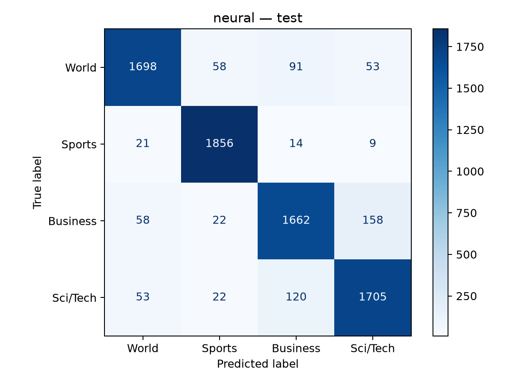
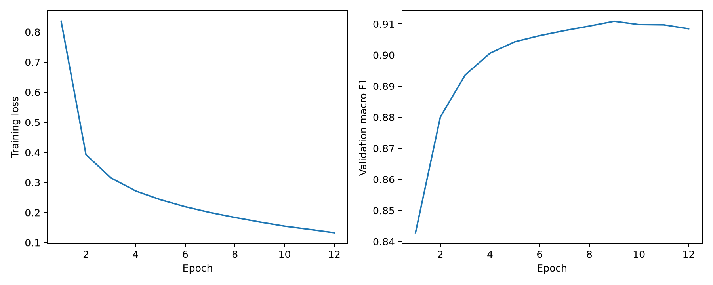

# News Article Topic Classification

Compare TF-IDF plus logistic regression with a compact neural text classifier on AG News. A majority-class dummy model provides a minimal reference. Measured validation and test results from the completed experiment are included in `results/`.

## Start in VS Code on macOS

Open this folder in VS Code. Install Microsoft's Python extension. Open Terminal → New Terminal, then run each command:

```bash
python3 -m venv .venv
source .venv/bin/activate
python -m pip install -r requirements.txt
python "ML project.py" prepare
python "ML project.py" train
```

If `.venv` already exists, skip its creation. Use Python 3.11–3.13. Training defaults to CPU, four PyTorch threads, and at most 12 neural epochs. A GPU is not required. In VS Code, select `.venv/bin/python` with “Python: Select Interpreter”. Reopen terminals require `source .venv/bin/activate` again.

`prepare` downloads data and saves the fixed training/validation split. `train` trains all three models and selects the neural checkpoint by validation macro F1, with patience 3. Read the validation results before final testing. Changing models after seeing test performance invalidates the held-out evaluation.

Once the model choices and preprocessing are final:

```bash
python "ML project.py" evaluate
python "ML project.py" predict --text "The team won the championship after a dramatic final."
python -m pip freeze > requirements-lock.txt
```

`evaluate` refuses to overwrite an existing test-results folder. `train` refuses to run after test evaluation. Do not bypass these guards to tune on the test set. Preserve `requirements-lock.txt` with your submission; dependencies in `requirements.txt` are compatible ranges rather than an exact environment lock.

## What the code does

1. Downloads original train/test CSV files using HTTPS verification with the certifi certificate bundle, and records source URLs and SHA-256 checksums.
2. Combines title and description, normalizes whitespace/case for duplicate detection, removes empty texts, removes every copy of texts with contradictory labels, then keeps one copy of remaining exact duplicates.
3. Removes training-pool texts or nonempty normalized headlines overlapping the test file. Only test text is used for this overlap audit, not its labels or performance.
4. Uses one fold of stratified group splitting for validation (approximately 20%). Identical normalized headlines stay together. Arbitrary near duplicates with different headlines are not detected; disclose this limitation.
5. Fits TF-IDF and the neural vocabulary on training data only. Every model uses the same split.
6. Reports validation and then final test accuracy, macro F1, per-class recall, confusion matrices, and example errors. The test set uses the same predeclared duplicate/conflicting-label policy, and the audit for this run retained all 7,600 test examples.

The stricter headline grouping and test-overlap audit differ from the initial Colab experiment. Counts and scores will differ; do not combine results from different splits into one comparison table.

## Models and settings

- Dummy: most frequent training class.
- Linear: TF-IDF with 50,000 features, unigrams/bigrams, minimum document frequency 2, sublinear term frequency; logistic regression with C=1 and max_iter=1000.
- Neural: training-only vocabulary of up to 20,000 words; up to 120 tokens/article; 64-dimensional learned embeddings; masked mean pooling; 64-unit ReLU layer; dropout 0.3; four outputs. Adam learning rate 0.001, batch size 256, cross-entropy loss. Padding index 0 and unknown index 1. This is a small neural text classifier trained from scratch, not a pretrained language model.
- Seed: 42. Exact results can still vary across dependency versions and platforms. Training metadata records time, Python/PyTorch versions, and platform. Record your CPU model and RAM separately in your report.

## Files and results

- `ML project.py`: all preparation, training, evaluation, and prediction code.
- `data/`: downloaded data and prepared splits; excluded from Git.
- `outputs/data_audit.json`: cleaning and split counts.
- `outputs/data_sources.json`: source URLs and file hashes.
- `outputs/validation_comparison.csv`: validation comparison.
- `outputs/learning_history.csv` and `learning_curves.png`: neural learning progress.
- `outputs/training.json`: measured training settings/timing.
- `outputs/test_comparison.csv`: final test comparison after evaluation.
- `outputs/validation/` and `outputs/test/`: metrics, confusion matrices, and first 100 errors per model.
- `outputs/*.joblib`, `neural.pt`, and `vocabulary.json`: saved models and vocabulary.

Outputs are excluded from Git by default because error examples contain dataset text and model artifacts can be large. The `results/` directory contains the aggregate metrics, charts, and learning history for submission; provide data access instructions rather than redistributing news text. Load only model files you created/trust.

## Measured results

Training: 94,924 articles. Validation: 23,732 articles. Test: 7,600 articles (1,900 per topic).

| Model | Test accuracy | Test macro F1 |
| --- | ---: | ---: |
| Majority baseline | 25.00% | 0.1000 |
| TF-IDF + logistic regression | 91.61% | 0.9159 |
| Compact neural classifier | 91.07% | 0.9105 |

The linear model scored slightly higher in this single run. This difference has not been tested for statistical significance. Neural checkpoint selection used validation macro F1; epoch 9 was retained. Test results were not used for tuning.





## Assistance disclosure

OpenAI Codex generated the initial project code, tests, and README, helped diagnose the certificate issue, and assisted with result interpretation. The student ran training, test evaluation, and the prediction demonstration. Review and update this disclosure to reflect any subsequent contributions accurately; the report requires its own AI-use statement.

## Dataset and citation

AG News labels: 1 World, 2 Sports, 3 Business, 4 Sci/Tech. Original benchmark: 120,000 training and 7,600 test examples.

- CSV distribution and accompanying original dataset description: https://github.com/mhjabreel/CharCnn_Keras/tree/master/data/ag_news_csv
- Original corpus page: http://www.di.unipi.it/~gulli/AG_corpus_of_news_articles.html
- Cite: Xiang Zhang, Junbo Zhao, Yann LeCun (2015). *Character-level Convolutional Networks for Text Classification*. Advances in Neural Information Processing Systems 28.

The accompanying dataset description states research and other non-commercial use. Record the source and usage terms; do not assume that a code repository licence grants unrestricted rights to the news articles. CSVs are downloaded from a third-party mirror; checksums document the exact downloaded files.

## Your assignment

Deadline supplied: 13 October 2026, 23:59; verify the timezone in Teams. Required: student-written Overleaf PDF, GitHub link, 2-minute code demonstration, and 10-minute presentation video. The assignment requires an honest AI-use statement and below 20% AI-generated report content. Explain the supplied code in your own words, understand its decisions, and disclose AI coding assistance. This repository does not supply your report or claim the work is complete.

## Checks

```bash
python -m unittest discover -s tests -v
```

These tests use synthetic fixtures to check data cleaning, deterministic disjoint grouping, and neural padding behavior. They do not measure real model quality.
